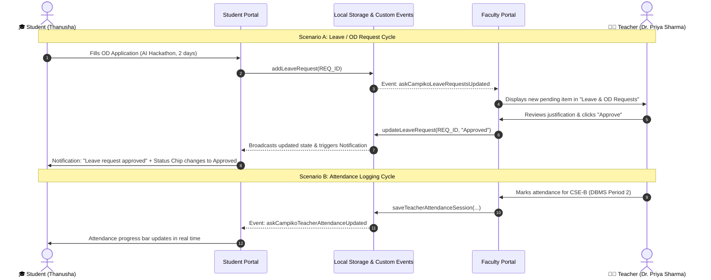

# 🎓 Ask Campiko — Next-Gen Smart Campus Management & Academic Copilot

<div align="center">


<br/>

**Your campus. Your questions. One unified, intelligent platform.**

[](https://react.dev/)
[](https://vitejs.dev/)
[](https://lucide.dev/)
[](LICENSE)
[]()
[]()
[]()

[Explore Features](#-core-features-at-a-glance) •
[Interactive Architecture](#-interactive-architecture--data-flow) •
[Quick Start](#-quick-start--installation) •
[Demo Credentials](#-demo-credentials--role-switcher) •
[Project Structure](#-project-directory-structure) •
[Roadmap](#-roadmap)

</div>

---

## 🌟 Overview

**Ask Campiko** is a modern, high-performance web dashboard built to eliminate fragmentation in higher-education campus management. Built with **React 19** and **Vite**, Ask Campiko unites students, faculty, and administrators within a unified digital ecosystem.

From real-time attendance analytics and dynamic timetable schedules to digital leave & On-Duty (OD) approval workflows, simulated campus fee billing, and a built-in **AI Campus Assistant**, Ask Campiko streamlines campus operations into an accessible, responsive, and multilingual interface.

---

## 🚀 Core Features at a Glance

### 1. 🤖 Context-Aware AI Campus Assistant
- Embedded directly in the global **TopBar** search and command palette.
- Natural language query parser powered by `campusAssistant.js`.
- Instantly answers queries about:
  - Subject attendance percentages and risk status (e.g. *"What is my DBMS attendance?"*)
  - Daily & weekly class schedules (e.g. *"What classes do I have today?"*, *"Show timetable for Friday"*)
  - Pending assignments and deadlines (e.g. *"When is my next assignment due?"*)
  - Leave & On-Duty status (e.g. *"Is my hackathon OD approved?"*)
  - Campus amenities, room allocations, mentor details, and emergency contacts.

### 2. 👥 Dual-Role Portal Architecture
- **Student Dashboard (`STU2026001`)**:
  - Real-time attendance monitoring with mandatory 75% threshold visual alerts.
  - Interactive day-by-day timetable with classroom numbers, course codes, and teacher names.
  - Comprehensive Leave & On-Duty (OD) application engine with document upload and tracking.
  - Coursework & assignment submission management with scoring rubrics and download attachments.
  - Billing & fee status with instant payment simulation, receipts, and printable invoices.
  - Academic achievement history, badges, certifications, and campus event calendar.
  - Centralized teaching materials repository (lecture slides, notes, syllabus outlines).
- **Teacher / Faculty Portal (`FAC2026001`)**:
  - Real-time class session attendance recorder with automatic recalculation and student broadcast.
  - Coursework manager to draft, schedule, and assign tasks with point allocations and deadlines.
  - Leave & On-Duty review dashboard with one-click **Approve** / **Reject**, remarks, and status persistence.
  - Academic timetable overview for lecture schedules across multiple sections and semesters.
  - Student directory, mentor advising views, and faculty profile management.

### 3. 🌐 Multilingual Accessibility
- Full native language localization engine supporting:
  - 🇬🇧 **English** (Default)
  - 🇮🇳 **Tamil (`தமிழ்`)**
  - 🇮🇳 **Telugu (`తెలుగు`)**
- Instant zero-reload translation across navigation, status cards, forms, tables, and notifications.

### 4. ⚡ Live Event-Driven State Synchronization
- Decoupled client-side storage architecture (`teacherPortalStore.js` and `leaveRequestStore.js`).
- Uses browser `localStorage` combined with custom `window.dispatchEvent` events:
  - When a faculty member records attendance for a class, the student's dashboard reflects the new percentage instantly.
  - When an assignment is published by a teacher, student assignment queues refresh in real time.
  - When a student submits a Leave / OD request, it appears instantly in the faculty review queue.
  - When faculty approves or rejects an application, notifications and badge indicators update immediately.

### 5. 💳 Campus Financials & Billing Hub
- Complete breakdown of tuition, hostel, examination, laboratory, and library fees.
- Payment history tracking with transaction IDs, dates, and status chips (Paid, Pending, Overdue).
- Integrated modal payment simulator supporting UPI, Debit/Credit Card, and Net Banking.
- Printable, branded payment receipts and downloadable fee summaries.

### 6. 🔔 Smart Notification Drawer
- Centralized notification bell with active unread badge indicators.
- Categorized notifications for assignments, attendance drops, timetable rescheduling, and leave approvals.
- Direct-action navigation (clicking a notification routes directly to the relevant assignment or approval screen).

---

## 🏗️ Interactive Architecture & Data Flow

```mermaid
graph TD
    subgraph Client Application [Ask Campiko 2 Frontend (React 19 + Vite)]
        App[App.jsx - Root Controller]
        Auth[Login.jsx - Role-based Auth]
        Layout[DashboardLayout.jsx]
        TopBar[TopBar.jsx - AI Search & Notifications]
        Sidebar[Sidebar.jsx - Role-filtered Navigation]

        subgraph Modules [Portal Modules]
            StudentViews[Student Views: Home, Timetable, Attendance, Assignments, Leave, Billing, Events, Profile]
            TeacherViews[Teacher Views: Home, Timetable, Teaching Content, Attendance Logger, Assignment Creator, Leave Approvals]
        end

        subgraph Local Engines [In-Memory & Storage Services]
            AIEngine[Campus Assistant NLP Engine<br/>utils/campusAssistant.js]
            I18n[Localization Engine<br/>utils/localization.js]
            LeaveStore[Leave Request Store<br/>data/leaveRequestStore.js]
            TeacherStore[Teacher Portal Store<br/>data/teacherPortalStore.js]
            MockDB[Campus Mock Database<br/>data/mockData.js]
        end
    end

    Auth -->|Select Role & Login| App
    App --> Layout
    Layout --> Sidebar
    Layout --> TopBar
    Layout --> Modules

    TopBar -->|Natural Language Query| AIEngine
    TopBar -->|Language Selection| I18n
    TopBar -->|Fetch Unread Alerts| LeaveStore

    StudentViews -->|Apply OD / Leave| LeaveStore
    LeaveStore -->|Broadcast Event| TeacherViews
    TeacherViews -->|Approve / Reject| LeaveStore

    TeacherViews -->|Log Class Attendance| TeacherStore
    TeacherStore -->|CustomEvent: AttendanceUpdated| StudentViews

    TeacherViews -->|Publish Assignment| TeacherStore
    TeacherStore -->|CustomEvent: AssignmentsUpdated| StudentViews

    AIEngine --> MockDB
    AIEngine --> LeaveStore
    AIEngine --> TeacherStore
```

---

## 🔄 Cross-Portal Live Synchronization Workflow



---

## 🎨 Design System & UI Specs

Ask Campiko is styled using an accessible, tokenized **Royal Purple** palette engineered to eliminate eye fatigue while maintaining strong typographic contrast.

| Token | Hex Value | Semantic Purpose |
| :--- | :--- | :--- |
| `--primary` | `#6C4AB6` | Primary action buttons, active navigation states, brand accents |
| `--primary-dark` | `#4B2F82` | Button hover states, dark header emphasis |
| `--primary-light` | `#8B6DCC` | Input focus rings, secondary badges, soft highlights |
| `--purple-100` | `#F3EFFF` | Tab switchers, active card backgrounds |
| `--background` | `#FAF8FF` | Main canvas background (soft off-white) |
| `--surface` | `#FFFFFF` | Elevated card surfaces, modal sheets, popups |
| `--success` | `#2E9B67` | High attendance (≥75%), approved status, completed tasks |
| `--warning` | `#D89125` | Moderate attendance, pending requests, upcoming deadlines |
| `--danger` | `#D9536F` | Attendance critical warning (<75%), rejected requests, overdue fees |
| `--text-primary` | `#211735` | High-contrast body text & titles (WCAG AAA compliant) |

---

## 🔑 Demo Credentials & Role Switcher

The application includes pre-configured demo personas to test both student and teacher roles out of the box:

| Role | User Identifier / Email | Initial Password | Profile Details |
| :--- | :--- | :--- | :--- |
| **🎓 Student** | `STU2026001` <br/>*(or `23CSE001` / `thanusha.reddy@example.com`)* | `Campiko@123` | Thanusha Reddy • B.Tech CSE (Year 3, Sec B) |
| **👨‍🏫 Teacher** | `FAC2026001` <br/>*(or `priya.sharma@example.com`)* | `Campiko@123` | Dr. Priya Sharma • Associate Professor (CSE) |

> 💡 **Quick Fill Feature**: In the login view, click the role tab (**Student** or **Teacher**) and the form automatically fills the appropriate credentials. You can also click the quick hint button to fill or reset credentials anytime.

---

## 💻 Tech Stack & Dependencies

- **Frontend Core**: [React 19.2](https://react.dev/)
- **Build Tool & Bundler**: [Vite 8.3](https://vitejs.dev/)
- **Component Architecture**: Functional React with Hooks (`useState`, `useEffect`, `useMemo`, `useRef`, `useContext`)
- **Iconography**: [Lucide React](https://lucide.dev/) (200+ feather-optimized vector icons)
- **Code Linter**: [Oxlint](https://oxc.rs/) (Next-generation high-speed linter)
- **Styling**: Pure Modular CSS with CSS Custom Properties, flexbox layouts, CSS Grid, and zero runtime overhead
- **State & Data Store**: LocalStorage abstraction layer + browser custom events (`CustomEvent`)

---

## 📁 Project Directory Structure

```plaintext
AskCampiko2/
├── index.html                   # HTML Entry point
├── package.json                 # Dependencies & project scripts
├── vite.config.js               # Vite build configuration
├── .oxlintrc.json               # Oxlint configuration
├── README.md                    # Canonical project documentation
│
├── src/
│   ├── main.jsx                 # React root renderer
│   ├── App.jsx                  # Main application orchestrator & page router
│   ├── App.css                  # Login and layout container styling
│   ├── index.css                # Global base styles & normalize resets
│   │
│   ├── assets/                  # Static media, icons & brand logos
│   │   ├── hero.png
│   │   ├── react.svg
│   │   └── vite.svg
│   │
│   ├── components/              # Shared reusable UI components
│   │   ├── DashboardLayout.jsx  # Primary shell (Sidebar + TopBar + Content Area)
│   │   ├── SectionHeader.jsx    # Standardized section headings with action slots
│   │   ├── Sidebar.jsx          # Collapsible navigation drawer with role-based routes
│   │   ├── StatCard.jsx         # Analytics metric cards with trends & icons
│   │   └── TopBar.jsx           # Global search, AI assistant prompt, notifications & profile
│   │
│   ├── contexts/                # React Contexts
│   │   ├── languageContext.js   # Global localization context hook
│   │   └── LanguageProvider.jsx # Language state provider wrapper
│   │
│   ├── data/                    # Data sources, storage managers & mocks
│   │   ├── mockData.js          # Master database (students, faculty, courses, events)
│   │   ├── demoCredentials.js   # Demo password verification & credentials
│   │   ├── appPreferences.js    # User theme & notification persistence
│   │   ├── leaveRequestStore.js # Shared Leave & OD store with live dispatchers
│   │   └── teacherPortalStore.js# Teacher attendance & assignment broadcast store
│   │
│   ├── pages/                   # Application pages & route views
│   │   ├── DashboardLayout.jsx
│   │   ├── auth/
│   │   │   └── Login.jsx        # Dual-role authentication screen
│   │   │
│   │   ├── student/             # Student Experience Pages
│   │   │   ├── StudentHome.jsx          # Student dashboard & quick metrics
│   │   │   ├── Timetable.jsx            # Day & weekly class schedules
│   │   │   ├── Attendance.jsx           # Detailed attendance analytics & percentages
│   │   │   ├── AssignmentDetails.jsx    # Coursework view, rubrics & submissions
│   │   │   ├── Leave.jsx                # Leave & OD applications and status tracking
│   │   │   ├── Billing.jsx              # Fee dues, payments & receipts
│   │   │   ├── Events.jsx               # Campus calendar, hackathons & symposiums
│   │   │   ├── AchievementHistory.jsx   # Portfolio, certificates & awards
│   │   │   ├── TeachingContent.jsx      # Class syllabus, notes & reading resources
│   │   │   ├── Profile.jsx              # Student academic & personal info
│   │   │   └── Settings.jsx             # Language, theme, notification controls
│   │   │
│   │   └── teacher/             # Faculty Experience Pages
│   │       ├── TeacherHome.jsx          # Faculty dashboard & overview
│   │       ├── Timetable.jsx            # Faculty lecture timetable
│   │       ├── Attendance.jsx           # Live attendance marking interface
│   │       ├── Assignments.jsx          # Assignment creator & submission tracker
│   │       ├── LeaveApproval.jsx        # Student Leave & OD approval dashboard
│   │       ├── TeachingContent.jsx      # Subject module manager
│   │       └── Profile.jsx              # Faculty credentials & department info
│   │
│   ├── styles/                  # Cascading style sheets
│   │   ├── theme.css            # Tokenized purple design system variables
│   │   ├── dashboard.css        # Responsive dashboard component styles
│   │   └── App.css              # Authentication & card styles
│   │
│   └── utils/                   # Helper engines & utilities
│       ├── campusAssistant.js   # AI natural language search & intent matcher
│       └── localization.js      # English, Tamil, and Telugu translation dictionary
```

---

## ⚡ Quick Start & Installation

### Prerequisites
- **Node.js**: `v18.0.0` or higher (Node `v20+` recommended)
- **npm**: `v9.0.0` or higher (or `pnpm` / `yarn`)

### 1. Clone the repository
```bash
git clone https://github.com/your-username/askcampiko2.git
cd askcampiko2
```

### 2. Install dependencies
```bash
npm install
```

### 3. Launch local development server
```bash
npm run dev
```

Open your browser and navigate to:
```
http://localhost:5173
```

### 4. Build for production
```bash
npm run build
```
The optimized production bundle will be generated in the `dist/` directory.

### 5. Preview production build
```bash
npm run preview
```

### 6. Run linter
```bash
npm run lint
```

---

## 🧪 Comprehensive Feature Walkthrough

### 1. Testing the Student Flow
1. Open the application at `http://localhost:5173`.
2. Select the **Student** tab and sign in using `STU2026001` / `Campiko@123`.
3. Check the **Home** dashboard: notice the greeting, overall attendance percentage, upcoming classes for today, and pending assignments.
4. Open the **AI Assistant** in the TopBar:
   - Type: *"What is my attendance in Operating Systems?"*
   - Type: *"Do I have classes on Friday?"*
   - Type: *"When is my next assignment due?"*
5. Navigate to **Leave & OD**:
   - Fill out a new On-Duty request for an upcoming Hackathon.
   - Attach a proof document name and click **Submit Request**.
   - Notice the status immediately appears as `Pending`.
6. Navigate to **Billing**:
   - Review your outstanding tuition fees.
   - Click **Make Payment**, select UPI or Card, and confirm.
   - View your payment history and download or print a receipt.

### 2. Testing Cross-Portal Sync with Faculty
1. In another browser tab or after logging out, select **Teacher** and sign in with `FAC2026001` / `Campiko@123`.
2. Open **Leave & OD Requests**:
   - You will see the request submitted by Thanusha in real time!
   - Review the reason and click **Approve** or **Reject**.
3. Open **Attendance**:
   - Select Section **CSE-B**, pick **Database Management Systems**, and record attendance for students.
   - Click **Save Attendance**.
4. Log back in as **Student**:
   - Notice the notification bell badge with the leave approval notice.
   - View your updated attendance metrics.

### 3. Testing Multilingual Support
1. In the TopBar, open the language dropdown menu (or go to **Settings** > **Language**).
2. Switch from **English** to **Tamil (`தமிழ்`)** or **Telugu (`తెలుగు`)**.
3. Notice every menu item, card heading, status badge, and button instantaneously switches to the selected language without reloading the page.

---

## 🗺️ Roadmap

- [x] Dual-role portal (Student & Faculty).
- [x] Responsive layout with mobile sidebar drawer.
- [x] Built-in AI Campus Assistant with natural language parsing.
- [x] Subject-wise attendance calculation with threshold alerts (<75%).
- [x] Leave & On-Duty request and multi-step approval system.
- [x] Fee payment simulator with printable invoices.
- [x] Multi-language localization (English, Tamil, Telugu).
- [x] Real-time cross-tab state updates via local storage and custom events.
- [ ] **Phase 2**: Full backend integration (FastAPI / Node.js + PostgreSQL).
- [ ] **Phase 3**: JWT authentication with refresh tokens and RBAC.
- [ ] **Phase 4**: Digital Campus ID with rotating TOTP QR codes.
- [ ] **Phase 5**: Physical Gate Pass security scanner console.
- [ ] **Phase 6**: Push notification support via WebPush / Firebase Cloud Messaging (FCM).
- [ ] **Phase 7**: Native mobile companion app using React Native & Expo.

---

## 🤝 Contributing

Contributions are welcome! If you would like to contribute:
1. Fork the repository.
2. Create your feature branch (`git checkout -b feature/AmazingFeature`).
3. Commit your changes (`git commit -m 'Add some AmazingFeature'`).
4. Push to the branch (`git push origin feature/AmazingFeature`).
5. Open a Pull Request.

---

## 📄 License

This project is licensed under the **MIT License** — feel free to use, modify, and distribute for educational and commercial purposes.

---

<div align="center">

**Made with 💜 for smarter, more connected campuses.**  
*Ask Campiko Team • 2026*

</div>
